  

  
  
  
  
  

## Hola, soy Javier 👋

Soy ingeniero de IA y en **@backpropagando** explico la IA por dentro. Construyo modelos delante de la cámara, enseño las cifras reales (también cuando salen mal) y en el siguiente vídeo los arreglo.

> Hablando de IA, aprendiendo constantemente y compartiendo ideas.

- 🔨 **Ahora mismo:** vídeos en los que construyo una IA de cero y la pongo a prueba con datos públicos.
- 🧠 **Me encanta:** la clasificación, la visión por computador y entender por qué un modelo falla.
- 💬 **Pregúntame por:** métricas que engañan, datasets desbalanceados y cómo pasar de un notebook a algo que funciona.
- 📫 **Escríbeme:** [backpropagando@gmail.com](mailto:backpropagando@gmail.com)

## 🎬 Vídeos con código

Todo el código de los vídeos está en [**backpropagando_resources**](https://github.com/backpropagando/backpropagando_resources), listo para ejecutarlo con `uv`.

| N.º | Vídeo | Qué vas a ver | Código |
|:-:|---|---|---|
| 40 | Vamos a construir una IA que detecta ictus | Un modelo que acierta el 95 % y solo pilla 2 ictus de 50 | [`40_ictus`](https://github.com/backpropagando/backpropagando_resources/tree/main/40_ictus) |
| 41 | Mi IA acertaba el 95 %. Y la he empeorado | Pesos de clase y umbral: de 2 a 39 ictus de 50 | [`41_ictus_arreglo`](https://github.com/backpropagando/backpropagando_resources/tree/main/41_ictus_arreglo) |

## 🧰 Con qué trabajo

  
  
  
  
  
  
  
  
  
  

## 📊 En GitHub

  
  

  

---

  Si algo de aquí te sirve, déjale una ⭐ a <a href="https://github.com/backpropagando/backpropagando_resources">backpropagando_resources</a> y nos vemos en el próximo vídeo.

